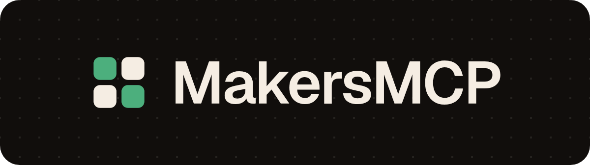

# 

Free kits for makers, one MCP. https://makersmcp.com

Open source kits for people who make things, from creators to product teams: image, video, sound, design and more. MakersMCP serves every kit to your agent through one MCP server, and they all run on your own machine, with no account or key.

## The kits

Each kit lives in its own repository and works on its own too, as a CLI and an agent skill.

| Field | Kit | Tools |
| --- | --- | --- |
| Design | [easybrandkit](https://github.com/EminBudak/easybrandkit): a website's logo files, colors, fonts and first screen | `make_brand_kit` |
| Design | [easyfontkit](https://github.com/EminBudak/easyfontkit): a site's fonts with their licenses and free look-alikes | `make_font_kit` |
| Image | [easyscreenshot](https://github.com/EminBudak/easyscreenshot): clean screenshots and a short demo video of a website | `take_screenshots`, `record_demo_video`, `check_pwa_screenshots` |
| Video | [launch-film](https://github.com/EminBudak/launch-film): a launch film with music, the launch pictures, and a check for any video | `make_launch_film`, `plan_launch_film`, `render_launch_film`, `make_launch_stills`, `check_video`, `launch_film_guide` |
| Sound | musicfit (soon): a music track cut to fit your video | `fit_music`, `analyze_music` |

More kits are on the way.

## Set it up

The first release on npm is on its way, so until it is out the `npx` setups below will not find the package; [run it from source](#run-it-from-source) works today. Star the repo to hear when it ships.

You need Node 22 or newer and the Chrome, Chromium, Edge or Brave you already have. The video and sound kits also need ffmpeg. Every setup runs `npx -y makersmcp@0.1.0`: keep the version in it, since `npx` can otherwise go on using an older copy it cached.

Then ask your agent for what you need, like "make a launch film for linear.app" or "get the brand kit and the fonts of stripe.com".

### Claude Code

```bash
claude mcp add makersmcp -- npx -y makersmcp@0.1.0
```

Check it with `claude mcp get makersmcp`, or `/mcp` inside Claude Code.

### Claude Desktop

Add this to `claude_desktop_config.json`, then quit Claude Desktop fully and open it again:

```json
{
  "mcpServers": {
    "makersmcp": {
      "type": "stdio",
      "command": "npx",
      "args": ["-y", "makersmcp@0.1.0"]
    }
  }
}
```

Claude Desktop starts servers outside any project, so the files go to `~/makersmcp`, which makersmcp makes with the first job. For another folder, add `"env": { "MAKERSMCP_OUT": "<folder>" }` to the entry, like `"~/Documents/makersmcp"`: a leading `~` is your home folder.

### Cursor

Open the command palette (Cmd+Shift+P, or Ctrl+Shift+P on Windows and Linux), run "Open MCP settings" and add:

```json
{
  "mcpServers": {
    "makersmcp": {
      "command": "npx",
      "args": ["-y", "makersmcp@0.1.0"]
    }
  }
}
```

### VS Code

```bash
code --add-mcp '{"name":"makersmcp","command":"npx","args":["-y","makersmcp@0.1.0"]}'
```

### Codex

```bash
codex mcp add makersmcp -- npx -y makersmcp@0.1.0
```

### Windsurf

Open Settings, then MCP, and add the same entry as for Cursor.

### OpenClaw

Add it under `mcp.servers` in your OpenClaw config:

```json
{
  "mcp": {
    "servers": {
      "makersmcp": {
        "command": "npx",
        "args": ["-y", "makersmcp@0.1.0"]
      }
    }
  }
}
```

Check it with `openclaw mcp doctor makersmcp --probe`.

### Hermes

Add it under `mcp_servers` in `~/.hermes/config.yaml`, then run `/reload-mcp`:

```yaml
mcp_servers:
  makersmcp:
    command: "npx"
    args: ["-y", "makersmcp@0.1.0"]
    timeout: 60
```

### Other clients

Any MCP client that runs stdio servers can start it with `npx -y makersmcp@0.1.0`.

### Run it from source

```bash
git clone https://github.com/EminBudak/makersmcp.git
cd makersmcp
npm install
npm run build
```

In any setup above, use `node` as the command and the full path of `dist/index.js` as its argument. `node dist/index.js --check` lists the kits it found, Chrome, ffmpeg and the folder it saves to.

## Pick your kits

Every kit is on unless you say otherwise. To give your agent fewer tools, name the kits you use:

```bash
npx -y makersmcp@0.1.0                                   # every kit
npx -y makersmcp@0.1.0 --kits all                        # every kit, the same
npx -y makersmcp@0.1.0 --kits easybrandkit,launch-film   # only these two
```

In a client's settings, the same goes at the end of `args`, like `["-y", "makersmcp@0.1.0", "--kits", "easybrandkit,launch-film"]`.

## Where the files go

Every tool saves its files in a folder and returns the folder, the files in it and the kit's own notes, like BRAND.md. The folders go where makersmcp starts, which is your project for a coding agent, or `~/makersmcp` when it can't write there; a folder that is not there yet is made with the first job. Choose another place with `--out <dir>` or `MAKERSMCP_OUT`, or give a tool its own `out_dir`.

A long job, like rendering a film, keeps going after the tool returns. The tool then gives back a `job_id`, and your agent calls `wait_for_job` with it until the job ends. `list_jobs` and `cancel_job` do what they say, and `check_setup` tells what is missing when a kit fails to start. When the client closes makersmcp, or makersmcp ends some other way, its jobs stop too, with the browsers and ffmpeg they started.

## When something fails

- The tools don't appear: check that `node --version` says 22 or newer, then restart the client. `npx -y makersmcp@0.1.0 --check` lists what makersmcp found.
- A kit can't find Chrome or ffmpeg: set `CHROME_PATH` and `FFMPEG_PATH` in the server's `env`. launch-film reads `LAUNCH_FILM_CHROME` and `LAUNCH_FILM_FFMPEG`.
- A long job meets the client's time limit: no call waits longer than `wait_seconds`, 45 by default. A job still running then comes back with a `job_id` and `next_action: wait_for_job`, and the agent should call that, never the first tool again, which would start a second job. Where a client lets you set a tool timeout, keep it above 45 seconds.

## Settings

| Option | Environment | What it does |
| --- | --- | --- |
| `--kits <list>` | `MAKERSMCP_KITS` | turns on only these kits, like `easybrandkit,launch-film`; leave it out or give `all` for every kit |
| `--out <dir>` | `MAKERSMCP_OUT` | where the folders go, made with the first job; `~` is your home folder |
| `--kit-path <kit>=<dir>` | `MAKERSMCP_KIT_PATHS` | uses a kit's checkout instead of its package |
| `--check` | | prints the kits, Chrome, ffmpeg and the folder, and exits |

## Use it in your own server

```js
import { serveStdio } from 'makersmcp';

await serveStdio({ kits: ['easybrandkit', 'launch-film'], outDir: '/srv/makersmcp' });
```

`serveStdio` serves on stdin and stdout and ends the process when the client goes away. `createMcpServer` takes the same options, `kits`, `outDir`, `kitPaths`, `definitions` and `backend`, and works over any MCP transport; close the server when the client is gone, since the stdio transport alone never notices. The backend decides where the jobs run. The default, `LocalBackend`, runs them on this machine and stops them when the server closes or the process ends. A service that runs kits for others can give `LocalBackend` an `env` of its own, so its secrets never reach a kit, and `confine: true`, so no tool call can name a file or folder outside `baseDir`. A service can also pass its own `KitBackend` ([src/backend.ts](src/backend.ts)) to run them on its machines; the tools then take links instead of paths and return links to the files. `loadKitDefinitions`, `validateKitDefinition`, `buildCommand` and `describeSetup` are exported too.

## Add a kit

makersmcp has no code for any kit. Each kit is a JSON file in [kits/](kits) that names its npm package, its tools, and how each tool's parameters become the kit's arguments. A new kit is a new file there and its package in `package.json`; removing a kit is the reverse. [docs/kits.md](docs/kits.md) describes the file.

## Develop

```bash
npm install
npm test
```

To try a kit from its checkout before it is on npm, start makersmcp with `--kit-path <kit>=<folder>`, like `--kit-path musicfit=../musicfit`. `npm test` tries the bounds of every number in kits/ with each kit that is installed; `MAKERSMCP_KIT_PATHS=musicfit=../musicfit npm test` tries a checkout's too.

[MIT](LICENSE)
